# Design

How the scheduling system is put together, in pictures and plain words.

The diagrams are written in Mermaid. GitHub, GitLab, VS Code and IntelliJ show them as drawings.

Contents:

1. [The big picture](#1-the-big-picture)
2. [What is inside the backend](#2-what-is-inside-the-backend)
3. [The classes](#3-the-classes)
4. [The database](#4-the-database)
5. [What happens when a schedule is saved](#5-what-happens-when-a-schedule-is-saved)
6. [What happens when an alarm rings](#6-what-happens-when-an-alarm-rings)
7. [How timing becomes a Quartz alarm](#7-how-timing-becomes-a-quartz-alarm)
8. [Task schemas: how a new task shows up everywhere by itself](#8-task-schemas-how-a-new-task-shows-up-everywhere-by-itself)
9. [Run history (added beyond the brief)](#9-run-history-added-beyond-the-brief)
10. [How errors travel](#10-how-errors-travel)
11. [What is inside the frontend](#11-what-is-inside-the-frontend)

---

## 1. The big picture

Three containers. The browser only ever talks to nginx.

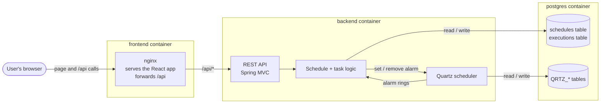

Two ideas hold the whole thing together:

- **Our table says what the user asked for. Quartz says when to wake up.** The `schedules` row holds the task, the timing and the inputs. Quartz holds only an alarm with the schedule's id on it.
- **Both are saved together.** The row and the alarm are written in one database transaction, so they can never disagree.

---

## 2. What is inside the backend

Code is grouped by topic. The arrows show who uses whom, and between packages they only ever point one way.

- Nothing in `task` knows that schedules or Quartz exist.
- Setting and ringing alarms is Quartz's job, and the schedule logic does not see it: it talks to a small interface, `ScheduleAlarms` ("set an alarm, remove an alarm"), and the `schedule.quartz` package plugs in behind it. One place in `schedule` does use the Quartz library directly: `ScheduleValidator` calls Quartz's `CronExpression` to check a cron text, because Quartz is what defines that syntax.

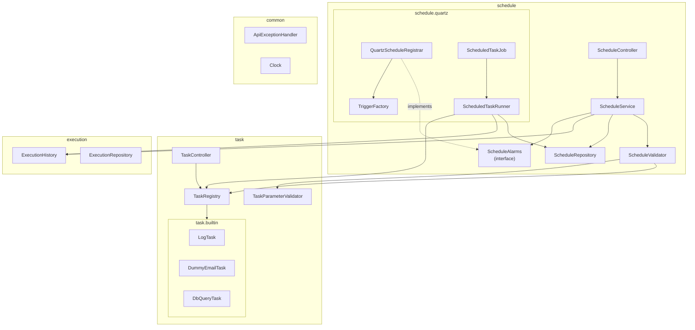

| Package | Job |
|---|---|
| `task` | The fixed list of tasks, what inputs each one declares, and checking values against that declaration |
| `task.builtin` | The three tasks themselves |
| `schedule` | The API, the rules for a valid schedule, and saving it |
| `schedule.quartz` | Everything that touches Quartz: making alarms, and running the task when one rings |
| `execution` | The run history: writing down each finished run and reading it back. It knows a schedule only by its id |
| `common` | Turning errors into API answers, and a single source of "now" |

---

## 3. The classes

### Tasks

A task is one class with two methods: "describe yourself" and "run".

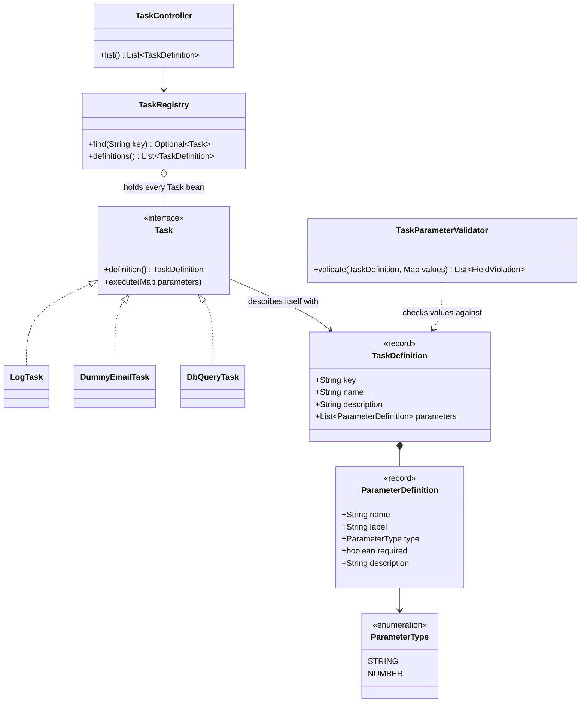

### Schedules and Quartz

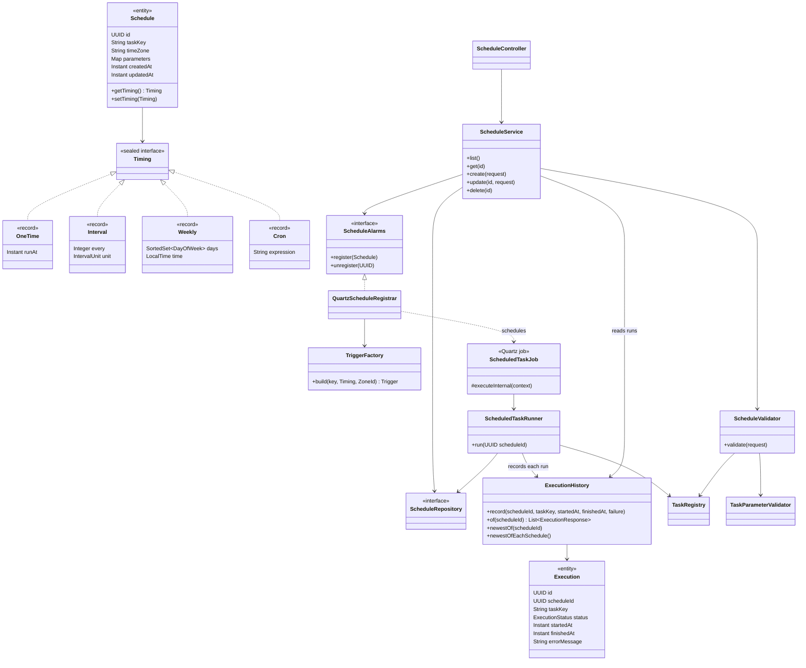

Why `Timing` is a sealed interface with four records: the Java compiler then insists that every `switch` over a timing handles all four kinds. Adding a fifth kind would not compile until the validator, the trigger factory and the entity all handle it.

---

## 4. The database

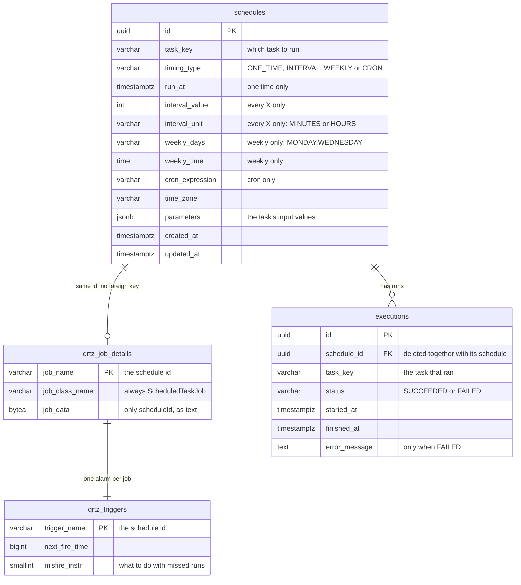

- Only the timing columns of the current kind are filled; the others are empty. The database enforces this itself with a `CHECK` rule in the table definition: a one-time row must have `run_at` and nothing else, an interval row must have a number of 1 or more and a unit, and so on. A row that breaks the rule is refused, whoever writes it.
- Task inputs are stored as JSON because each task has different inputs.
- The link to Quartz is by name: the Quartz job and trigger are both named after the schedule's id. There is no foreign key, because Quartz owns its tables. Staying in step is guaranteed by the shared transaction instead (next section).
- A one-time schedule that already ran has **no** Quartz rows any more: Quartz removes a finished alarm by itself. The `schedules` row stays until the user deletes it.
- `executions` holds one row per finished run. It has a real foreign key to `schedules`, so deleting a schedule removes its runs with it.
- Both sets of tables are created by Flyway on first start (`V1` ours, `V2` Quartz's). Quartz has more tables than shown; these are the ones that matter here.

---

## 5. What happens when a schedule is saved

Create is shown. Edit is the same, except it loads the existing row first. Delete removes the row and the alarm in the same way.

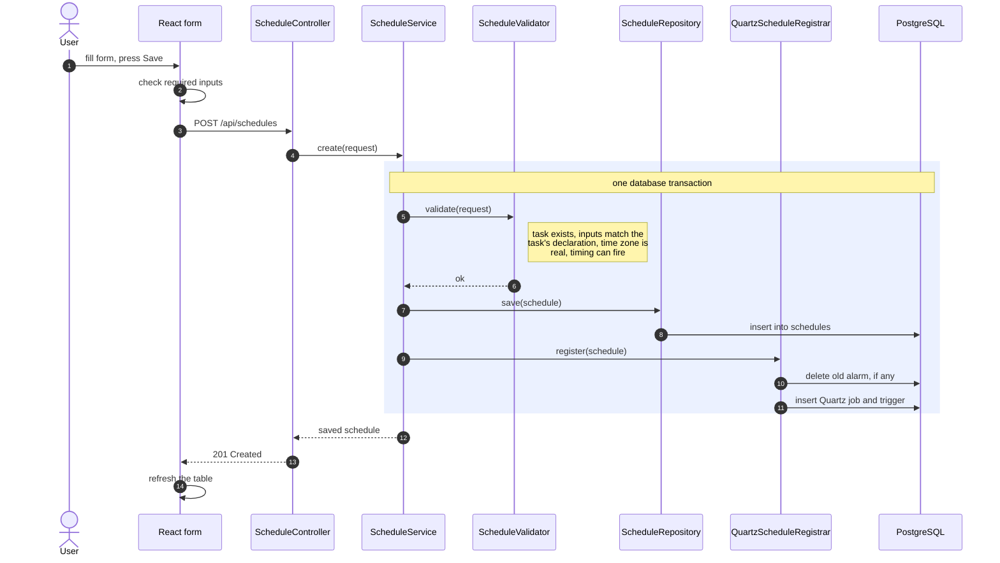

If any step inside the box fails, everything in the box is undone. That holds in both directions, and two integration tests prove it:

- Quartz refuses the alarm → no `schedules` row is left.
- Something fails after Quartz accepted the alarm → no Quartz job or trigger is left.

**Why "delete old alarm" happens on every save, even on create:** it makes one code path serve create and edit, it guarantees there is never more than one alarm per schedule, and it quietly covers the one-time schedule whose alarm Quartz already removed.

If validation fails (step 6), nothing is written and the API answers 400 with one message per field (see [section 10](#10-how-errors-travel)).

---

## 6. What happens when an alarm rings

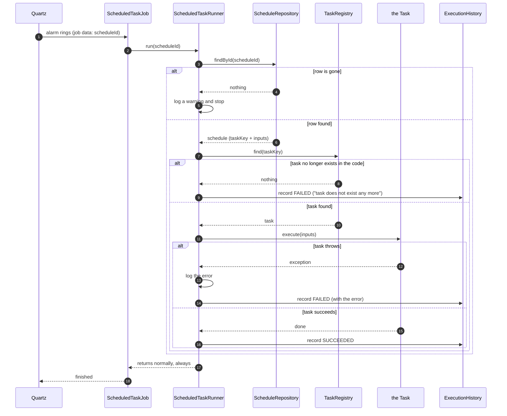

Four choices are visible here:

- **The job is always the same class.** Quartz does not know about tasks. The task is looked up at the moment of running, from our own table. So editing a schedule's inputs never leaves old values stuck inside Quartz.
- **Nothing escapes the runner.** A failing task is logged and the scheduler carries on. The next run of the same schedule still happens.
- **Every finished run is written down.** Success or failure, with start time, end time and the error if there was one. Writing it down is itself guarded: if the history cannot be written (for example the schedule was deleted while its task was still running), the run is not affected. See [section 9](#9-run-history-added-beyond-the-brief).
- **A schedule never overlaps itself.** `ScheduledTaskJob` is marked `@DisallowConcurrentExecution`. If a run is still going when the next one is due, the next one waits. Different schedules still run side by side.

---

## 7. How timing becomes a Quartz alarm

`TriggerFactory` is the only place that knows this table.

| Timing kind | Quartz trigger | Example | If the run was missed (server was down) |
|---|---|---|---|
| One time | simple trigger, fires once | at `2026-12-01T07:00:00Z` | run it once, as soon as the server is back |
| Every X | simple trigger, repeats forever, first run one gap from now | every 15 minutes | skip the missed runs, continue at the next normal time |
| Weekly | cron trigger, built from days and time | Mon + Wed 08:30 → `0 30 8 ? * MON,WED` | skip, wait for the next normal time |
| Cron | cron trigger, the user's text as is | `0 0/5 * * * ?` | skip, wait for the next normal time |

- Four kinds, but only two Quartz trigger types.
- Weekly and cron alarms carry the schedule's time zone, so 08:30 stays 08:30 local time when the clocks change. The zone is set when the schedule is created (the browser's zone) and kept when it is edited, even from another zone.
- Weekly uses day **names** (`MON`), not numbers, because in Quartz the number 1 means Sunday.

---

## 8. Task schemas: how a new task shows up everywhere by itself

### The idea

Every task carries a small description of its own inputs. We call that description its **schema**:

| For each input | Example |
|---|---|
| name | `message` |
| label (what the user sees) | `Message` |
| type | `STRING` or `NUMBER` |
| required or optional | required |
| a short hint | `The text to write to the log.` |

The schema is written **once**, inside the task's class. Every other part of the system reads it from there instead of having its own copy:

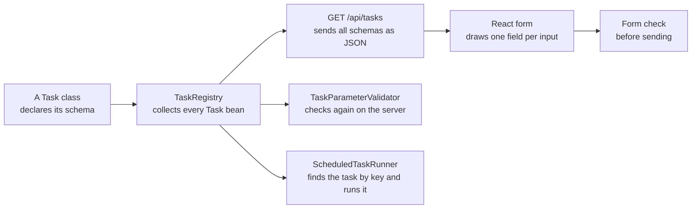

Because there is one source, the pieces cannot drift apart. The form can never show a field the server does not accept, and the server can never demand a field the form does not show.

### The journey of a schema

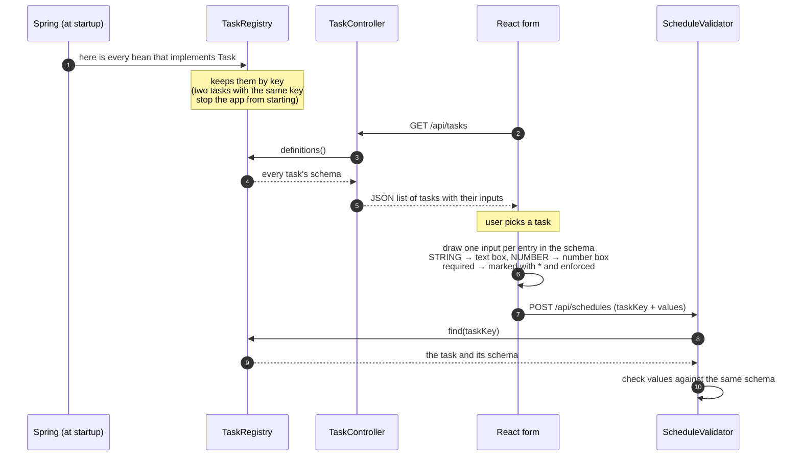

What the JSON looks like for one task:

```json
{
  "key": "email",
  "name": "Dummy Email Task",
  "description": "Pretends to send an email. It is only written to the application log.",
  "parameters": [
    { "name": "to",      "label": "To",      "type": "STRING", "required": true,  "description": "Who receives the email." },
    { "name": "subject", "label": "Subject", "type": "STRING", "required": true,  "description": "The subject line." },
    { "name": "body",    "label": "Body",    "type": "STRING", "required": false, "description": "The text of the email." }
  ]
}
```

### Adding a new task: one class

This example is **not in the repository**. It shows what you would write to add a task that calls a URL.

```java
package com.schedulingsystem.scheduler.task.builtin;

@Component
@Order(4)   // position in the task list
public class HttpPingTask implements Task {

    private static final TaskDefinition DEFINITION = new TaskDefinition(
            "http-ping",                                   // key, saved with each schedule
            "HTTP Ping Task",                              // name shown in the dropdown
            "Calls a URL and logs the status code.",       // hint shown under the dropdown
            List.of(
                    ParameterDefinition.required("url", "URL", ParameterType.STRING,
                            "The address to call."),
                    ParameterDefinition.optional("timeoutSeconds", "Timeout (seconds)", ParameterType.NUMBER,
                            "How long to wait. Default: 5.")));

    @Override
    public TaskDefinition definition() {
        return DEFINITION;
    }

    @Override
    public void execute(Map<String, Object> parameters) throws Exception {
        String url = (String) parameters.get("url");               // required: always present
        Number timeout = (Number) parameters.get("timeoutSeconds"); // optional: may be null
        // ... call the URL and log the result
    }
}
```

That is the whole change. After a restart, without touching any other file:

| Where | What happens by itself |
|---|---|
| `TaskRegistry` | Spring hands it the new bean; it is now findable by `http-ping` |
| `GET /api/tasks` | the list has a fourth entry with the two inputs |
| Task dropdown in the UI | "HTTP Ping Task" appears |
| The form | picking it draws a required text box "URL" and an optional number box "Timeout (seconds)", each with its hint |
| Form check | Save is blocked while "URL" is empty or "Timeout" is not a number |
| Server check | a request without `url`, with text in `timeoutSeconds`, or with an unknown input is rejected with a message on that field |
| Running | a schedule that uses `http-ping` runs this class, with the saved values |
| The table | the row shows "HTTP Ping Task" and its inputs with their labels |

What the task can rely on inside `execute`: required inputs are there, and every value has the declared type (`STRING` is a Java `String`, `NUMBER` is a Java `Number`). The validator has already made sure before the schedule was saved.

**How this was checked.** An integration test (`GenericTaskIntegrationTests`) does exactly what this section describes, with a task that exists only in the test sources and that no application code mentions. It checks that the API lists the task with its inputs, that a missing required input, a wrong type and an undeclared input are each rejected, and that Quartz runs the task with the saved values.

Beyond that test, the three existing tasks reach the UI only through this path. A search of the frontend's application code finds zero lines that mention a specific task, and in the backend no class outside `task.builtin` refers to a concrete task class.

### What is *not* automatic

Being honest about the edges:

- **Tests.** One integration test (`TaskApiIntegrationTests`) asserts that the task list is exactly the three current tasks. It would need the new task added. The new task also deserves its own unit test.
- **A new *type* of input** (for example yes/no, or a date). The schema knows two types. A third one means touching three places: the `ParameterType` enum, `TaskParameterValidator` (what counts as that type), and the frontend's `TaskParameterFields` (which input to draw). The compiler points at the first two, because their `switch` statements stop compiling.
- **Rules beyond "type" and "required"** (a minimum, a maximum, a pattern). The schema has no place for them. Today a task handles that itself, the way `DbQueryTask` quietly keeps `limit` between 1 and 100.
- **Changing a task that schedules already use.** Inputs are checked when a schedule is *saved*, not when it runs. If a task later gains a required input, old schedules still hold the old values and the task will receive them as they are. If a task is removed from the code, its schedules stay in the table and each run logs an error and does nothing.

---

## 9. Run history (added beyond the brief)

**The assignment does not ask for this.** It asks for a table of schedules and a form. But with only that, a user creates a schedule and then sees nothing happen: the only proof that a task ran is a line in the server log. I thought a scheduling tool is not really usable without seeing what ran and whether it worked, so this one feature was added on purpose.

### What the user gets

- A **Last run** column in the table: "Succeeded" or "Failed" with the time, or "Not run yet".
- A **Run history** button on each row. It opens a list of that schedule's past runs, newest first: when it started, how long it took, which task ran, the result, and the error message if it failed.
- Both keep themselves up to date. The page asks the server again every 5 seconds, so a run shows up without reloading.

### How it works

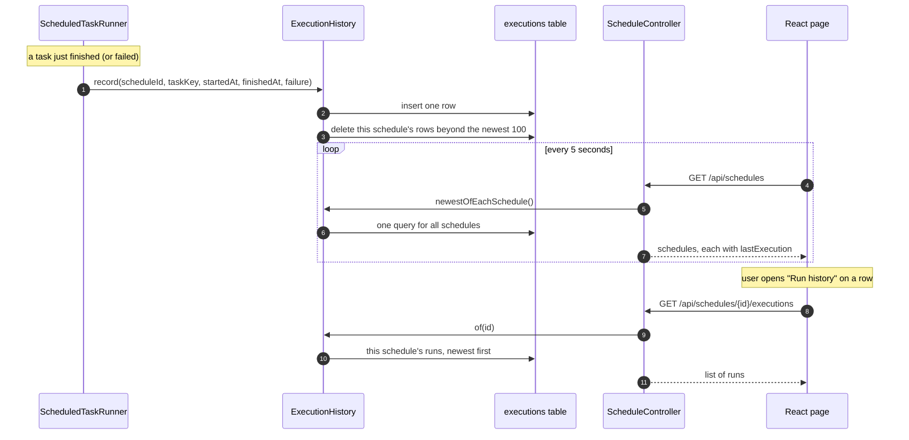

### The choices, and why

| Choice | Why |
|---|---|
| One row per run, written when the run **finishes** | One insert, no "running" state to clean up after a crash. The cost: a run in progress is not visible until it ends. |
| Only the newest **100** runs per schedule are kept | A schedule that fires every minute would otherwise add 1,440 rows a day forever. |
| The row stores the **task that ran** | A schedule can later be switched to another task; old runs should still say what really ran. |
| Deleting a schedule deletes its history (database `ON DELETE CASCADE`) | No orphan rows, and nothing extra to remember in the code. |
| The database checks the row: a failed run must have a reason, a successful one must not | The same idea as the timing rule in [section 4](#4-the-database): the table cannot hold a contradiction. |
| Writing history can never break a run | It is wrapped separately. If it fails, a warning is logged and the scheduler carries on. |
| The `execution` package knows a schedule only by its id | It has no dependency on the schedule code. The schedule code depends on it, not the other way round. |
| The table gets the newest run of **all** schedules in one query | The list does not get slower with one extra query per row. |
| The UI polls every 5 seconds | Tasks run on the server on their own, so the page cannot know without asking. Polling is the simplest thing that works; a push channel would be more machinery than this needs. |

### What it does not do

- A run that is still in progress is not shown.
- If the server is killed while a task is running, that run leaves no history row.
- There is no filtering, searching or paging: 100 rows per schedule fit in one list.
- The task's output is not captured, only whether it succeeded and, if not, the error.

---

## 10. How errors travel

Every error leaves the API in the same standard shape (RFC 9457 problem details). Validation errors add a list of `field` + `message`.

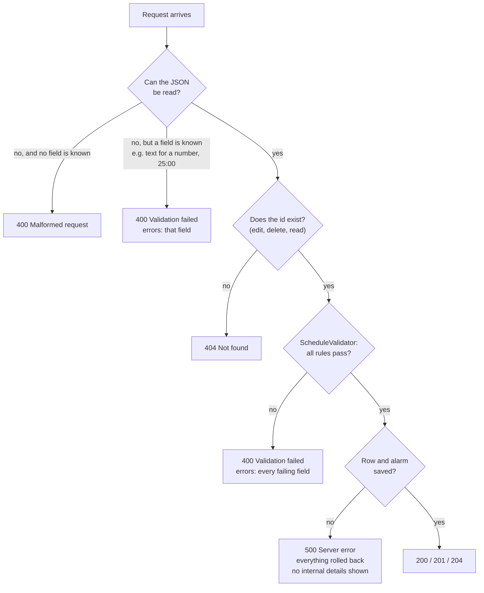

On the frontend:

- a `field` that matches an input on screen → the message appears under that input;
- anything else (an unknown field, a 500, no network) → one message at the top of the dialog;
- in both cases the dialog stays open and keeps what the user typed.

Field names the server uses: `taskKey`, `timing`, `timing.runAt`, `timing.every`, `timing.unit`, `timing.days`, `timing.time`, `timing.expression`, `timeZone`, `parameters.<input name>`.

---

## 11. What is inside the frontend

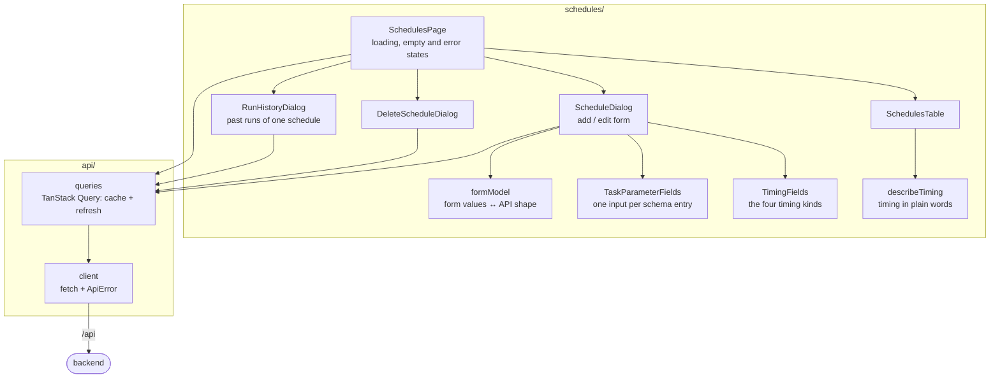

- **Server data lives in TanStack Query.** The task list is loaded once and kept. After a create, edit or delete, the schedule list is marked stale and reloads, so the table is always what the server has. The schedule list and an open run history are also asked for again every 5 seconds, because tasks run on the server without the page knowing.
- **The form is React Hook Form.** Only the fields of the chosen timing kind and the chosen task exist in the form at any moment, so fields of the other kinds are neither checked nor sent.
- **`formModel` is the translator.** HTML inputs give text. It turns that into the API shape: local date-time into a UTC moment, number inputs into JSON numbers, empty optional inputs into nothing at all. It also maps a server field name back to the input on screen.
- **`TaskParameterFields` is where the schema becomes a form** (see [section 8](#8-task-schemas-how-a-new-task-shows-up-everywhere-by-itself)).
